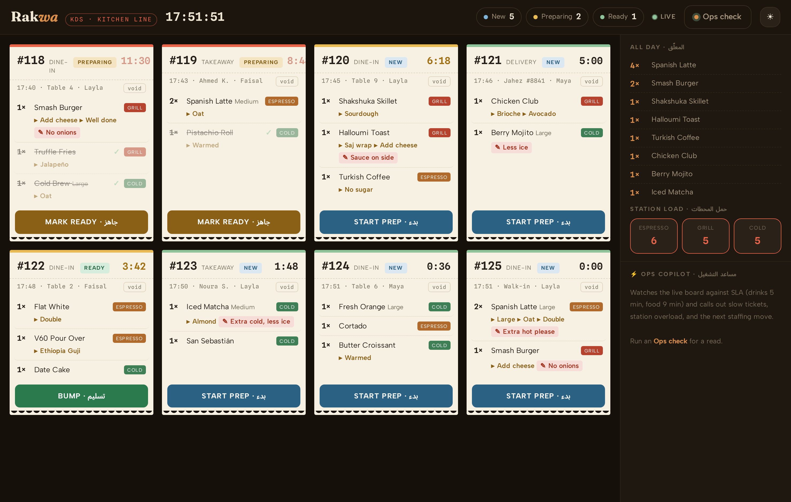
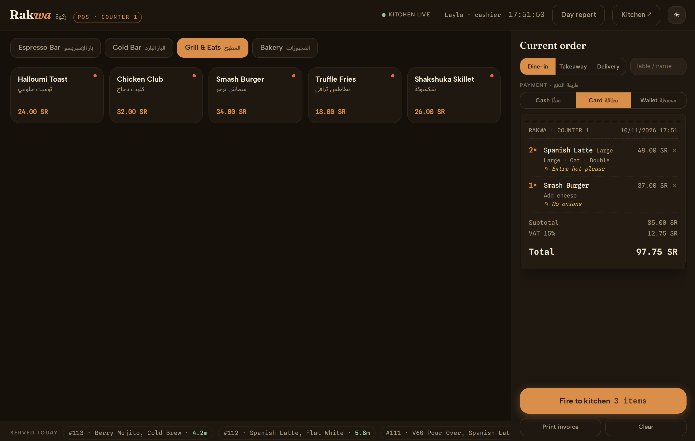
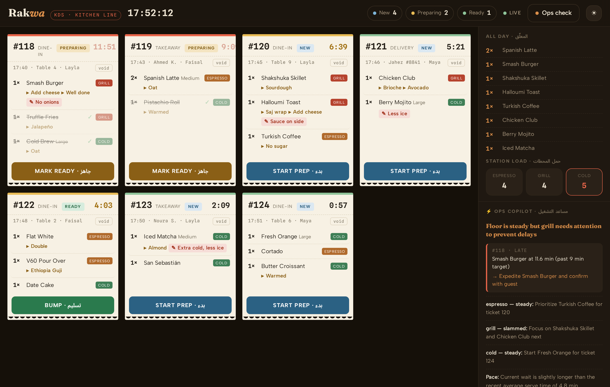
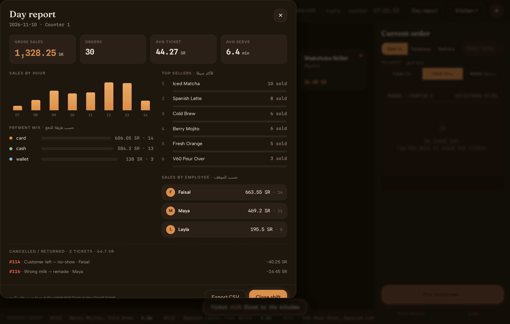

# Rakwa: café POS and live kitchen display

A coffee counter run from two screens that talk to each other live. The cashier builds an order on the **POS** (sizes, milk, extras, kitchen notes, payment) and fires it. The ticket lands on the **Kitchen Display** the same instant, as a thermal-receipt card with a prep timer that turns amber, then red, once it passes its target time. The kitchen taps it through *New → Preparing → Ready → Served*, and an **AI shift lead** reads the live board and calls out the slow ticket and the next staffing move.

رَكوة: نظام نقاط بيع وشاشة مطبخ فورية للكافيهات والمطاعم.




## What's inside

- **POS.** Menu by category, an options sheet per item (size, milk, espresso, bread, doneness, extras, each with its price change), quick kitchen-note chips, a live receipt with subtotal, 15% VAT and total, dine-in, takeaway or delivery, and cash, card or wallet payment.
- **Kitchen Display.** New tickets arrive with a soft chime. Each ticket has a timer against its target (drinks 5 minutes, food 9 minutes), every line can be struck off on its own, and a served ticket animates off the board.
- **Live link.** Server-Sent Events push every change to both screens, with a "kitchen live" indicator and automatic reconnect.
- **AI shift lead.** Reads a snapshot of the board and returns alerts that name the ticket, its minutes against target and the move to make, plus a load reading per station and a staffing call for the next 30 minutes. It only narrates numbers the system computed; it never invents a ticket or a time.
- **Day report.** Built from every closed ticket in SQL: gross sales, order count, average ticket, average serve time, sales by hour, payment mix, top sellers, sales per cashier, and voided tickets with reasons.
- Dark and light themes, English and Arabic labels, responsive layout, empty, loading and reconnecting states.




## Run it

No runtime dependencies: only Node 22.5 or newer (`node:http`, `node:sqlite`, `fetch`).

```bash
OPENROUTER_API_KEY=your-key npm start
```

Open the two screens side by side:

- POS: http://localhost:4933/pos
- Kitchen Display: http://localhost:4933/kds

Fire an order on the POS and it appears on the Kitchen Display. Without a key everything works except the AI check, which reports itself offline. The model defaults to `deepseek/deepseek-chat` and can be changed with `OPENROUTER_MODEL`.

The database is rebuilt on every start with a seeded menu, three cashiers, seven tickets in progress and one morning of trade, so the board and the day report always look like a live shift. Every order you place is a real insert, and the timers, totals, VAT and report figures are computed from the database.

## Tests

```bash
npm install && npx playwright-core install chromium
npm start &     # server on :4933
npm run e2e     # Playwright: builds an order, fires it, checks it arrives on the kitchen screen,
                # walks it through every status, opens the day report, runs one AI check, saves screenshots/
```

## Stack

Node built-ins at runtime, vanilla JavaScript and CSS custom properties (one design system shared by both screens), no framework and no build step. Playwright for the end-to-end test, OpenRouter for the AI call.

The café, menu and staff are fictional sample data.
